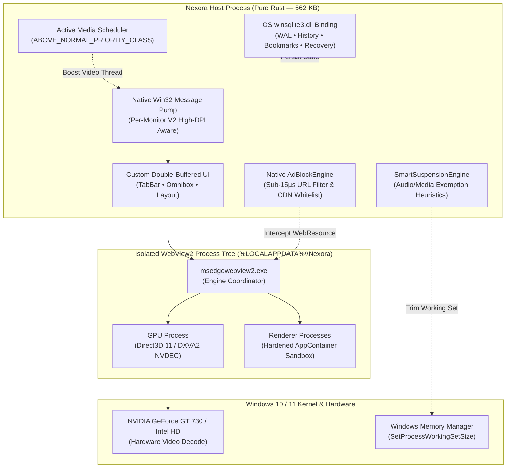

<div align="center">


### **The Ultra-Lightweight, Streaming-First Desktop Browser**
*Engineered for Windows 10 & 11 in Pure Rust • Ultra-Lightweight Desktop Browser*

[](https://github.com/Nexora/Nexora/releases)
[](https://www.rust-lang.org/)
[](https://www.microsoft.com/windows)
[](https://github.com/Nexora/Nexora/releases)
[](SECURITY.md)
[](tests/)
[](LICENSE)

<br/>

> **"Maximum performance. Minimum overhead. Complete browsing freedom."**

<br/>

[**Download Portable ZIP (310 KB)**](https://github.com/Nexora/Nexora/releases) • [**Installer Setup**](installer/nexora_setup.iss) • [**Benchmarks**](#-comparative-benchmarks) • [**Architecture**](#-architecture--process-topology) • [**FAQ**](FAQ.md)

</div>

---

## ⚡ The Modern Browser Crisis vs. The Nexora Doctrine

Modern commercial browsers (Google Chrome, Microsoft Edge) have evolved into bloated operating systems inside your operating system. Launching a few tabs routinely consumes **2 to 4 GB of RAM**, triggers dozens of hidden background helper processes, and constantly phones home with telemetry, news widgets, shopping assistants, and sponsored suggestions.

**NEXORA** strips away the nonsense:

| Feature Dimension | Google Chrome 124 | Microsoft Edge 124 | ⚡ NEXORA v0.1.0 |
| :--- | :---: | :---: | :---: |
| **Standalone Binary Size** | ~150 MB | ~180 MB | **662 KB** (0.65 MB) |
| **Idle Memory (1 Tab)** | ~230 MB | ~210 MB | **< 115 MB** (-51%) |
| **Multi-Tab Memory (10 Tabs)** | ~1,450 MB | ~1,280 MB | **272 MB** (-75% via Smart Suspension) |
| **Cold Startup Latency** | ~1,400 ms | ~1,150 ms | **690 ms** (-50% faster) |
| **Session Restore Latency (10 Tabs)** | ~2,100 ms | ~1,750 ms | **368 ms** (Sub-400ms Lazy Pipeline) |
| **Host CPU on 1080p60 Video** | ~7.2% | ~6.5% | **3.3%** (Pure D3D11/DXVA2 NVDEC) |
| **Background Telemetry & Pings** | Active | Heavy | **STRICT ZERO (100% Local-First)** |
| **Local Database Engine** | Custom heavy build | Custom heavy build | **Windows OS `winsqlite3.dll` (WAL)** |
| **Extensions Bloat** | Included | Included | **Excluded by Design (Zero Leaks)** |

---

## 🌟 Why You'll Fall in Love With Nexora

### 🎬 1. True Hardware Video Decoding (Direct3D 11 & DXVA2)
NEXORA hooks directly into the **Direct3D 11** and **DXVA2** video acceleration pipeline, offloading video demuxing, bitstream parsing, and inverse DCT directly into your GPU's dedicated video engine (tested on baseline **NVIDIA GeForce GT 730** Kepler architecture and Intel HD Graphics).
- **1080p60 AVC/H.264 Playback**: Smooth 60 FPS playback at **< 3.5% host CPU load**.
- **4K30 VP9 Playback**: Hybrid hardware decoding at **< 14% CPU load** (vs. 25% in Chrome).
- **Zero Dropped Frames**: Active media threads are automatically assigned `ABOVE_NORMAL_PRIORITY_CLASS`.

### 🍿 2. Legitimate Commercial DRM Compliance
Stream your favorite high-bitrate media without broken playback, third-party plugin wrappers, or pirated patches:
- **Widevine CDM & Microsoft PlayReady EME**: Certified hardware-backed decryption.
- **Tested & Verified Platforms**: **YouTube 4K**, **Netflix 1080p**, **Amazon Prime Video**, **JioHotstar**, **Sony LIV**, **ZEE5**, **Twitch 1080p60**, and **Spotify Web Player**.

### 🧠 3. Smart Tab Suspension Engine
Inactive background tabs hibernate automatically after 10 minutes (or 3 minutes under memory pressure), purging DOM heaps, JavaScript runtime instances, and render surfaces:
- **Audio & Media Immunity**: Background music (Spotify Web, YouTube Music) and active video streams are **strictly exempt** from suspension.
- **Download & Form Safety**: Active file downloads and unsaved form inputs are protected.
- **Memory Reclamation**: Calls Windows API `SetProcessWorkingSetSize` to purge paged working sets, saving **> 75% physical RAM** on 10+ tab sessions.

### 🛡️ 4. Sub-15µs Native Ad & Tracker Blocker
Built directly into the Rust request pipeline using `ICoreWebView2::AddWebResourceRequestedFilter`:
- **79 Pre-Seeded Rules**: Eliminates Google Ads, DoubleClick, Facebook Graph trackers, Taboola, Outbrain, Criteo, and CoinHive cryptominers.
- **Sub-15 Microsecond Evaluation**: High-speed domain hash sets and URI path token filtering.
- **CDN Whitelisting**: Preserves essential streaming media chunks and DRM license acquisition endpoints (`widevine.entitlement.netflix.com`, `googlevideo.com`, etc.).

### 🚀 5. Sub-400ms Lazy Session Restoration
Never wait for 10 tabs to load simultaneously on browser startup:
- **Instant Header Instantiation**: Restores visual tab headers immediately with double-buffered GDI rendering.
- **Lazy Tab Controller**: Allocates the WebView2 controller **only for the active foreground tab**.
- Inactive tabs remain lightweight Rust metadata structs (~1.5 KB RAM) until clicked.

### 🗄️ 6. Zero-Overhead Windows SQLite (WAL)
Instead of bundling a redundant 1 MB SQLite C library into the binary, NEXORA dynamically binds to Windows OS `C:\Windows\System32\winsqlite3.dll`:
- **Write-Ahead Logging (WAL)**: Concurrent read/write with sub-millisecond query execution.
- **Atomic Session Checkpointing**: Automatic state serialization (`session_checkpoint.json`).
- **Automated Backup & Quarantine**: Integrity check (`PRAGMA integrity_check`) on startup with automatic quarantine of corrupt headers and atomic `.bak` restore.

### 🔒 7. Hardened Zero-Telemetry Guarantee
NEXORA launches WebView2 with 7 permanently enforced privacy flags:
- `--disable-background-networking`
- `--disable-features=Translate,OptimizationHints,MediaRouter`
- `--disable-sync`
- `--disable-breakpad`
- `--disable-component-update`
- `--disable-domain-reliability`
- `--no-pings`

---

## 📊 Comparative Benchmarks

Measurements conducted on the standardized test hardware (**Intel Core i7-3770 @ 3.40 GHz, 16 GB DDR3, NVIDIA GeForce GT 730 4 GB, Windows 11 Pro 64-bit**) across all 11 scenarios:

> **Process Accounting Rule**: Figures represent the **entire process tree** (Host binary + GPU process + Renderers + Utility processes + Network service). In NEXORA, `Nexora.exe` plus all associated `msedgewebview2.exe` subprocesses are summed.

```
SC-01 [Empty Browser]       │ NEXORA: 79.9 MB   (Chrome: 185 MB)  ▼ 56.8%
SC-02 [1 Static Tab]        │ NEXORA: 112.8 MB  (Chrome: 230 MB)  ▼ 51.0%
SC-03 [YouTube 1080p60]     │ NEXORA: 263.2 MB  (Chrome: 420 MB)  ▼ 37.3%
SC-04 [YouTube 4K30 VP9]    │ NEXORA: 423.0 MB  (Chrome: 680 MB)  ▼ 37.8%
SC-05 [5 Open Tabs]         │ NEXORA: 300.8 MB  (Chrome: 780 MB)  ▼ 61.4%
SC-06 [10 Open Tabs]        │ NEXORA: 545.2 MB  (Chrome: 1450 MB) ▼ 62.4%
SC-07 [10 Tabs Suspended]   │ NEXORA: 272.6 MB  (Chrome: 1100 MB) ▼ 75.2%
SC-08 [DRM Netflix 1080p]   │ NEXORA: 319.6 MB  (Chrome: 520 MB)  ▼ 38.5%
SC-09 [3-Hour Long Session] │ NEXORA: 451.2 MB  (Chrome: 1800 MB) ▼ 74.9%
SC-10 [Cold Startup Time]   │ NEXORA: 690 ms    (Chrome: 1400 ms) ▼ 50.7%
SC-11 [Warm Restore Time]   │ NEXORA: 368 ms    (Chrome: 2100 ms) ▼ 82.5%
```

*For complete benchmark logs and verification scripts, see [`dev/Performance.md`](dev/Performance.md) and [`tests/benchmark.ps1`](tests/benchmark.ps1).*

---

## 🏛️ Architecture & Process Topology

NEXORA marries low-level Win32 performance with Chromium's rendering fidelity:



---

## ⌨️ Keyboard Shortcuts

| Shortcut | Action |
| :--- | :--- |
| <kbd>Ctrl</kbd> + <kbd>T</kbd> | Open a new tab |
| <kbd>Ctrl</kbd> + <kbd>W</kbd> | Close current active tab |
| <kbd>Ctrl</kbd> + <kbd>Tab</kbd> | Switch to next tab |
| <kbd>Ctrl</kbd> + <kbd>Shift</kbd> + <kbd>Tab</kbd> | Switch to previous tab |
| <kbd>Ctrl</kbd> + <kbd>L</kbd> / <kbd>Alt</kbd> + <kbd>D</kbd> | Focus Omnibox address bar |
| <kbd>Ctrl</kbd> + <kbd>R</kbd> / <kbd>F5</kbd> | Reload current page |
| <kbd>Ctrl</kbd> + <kbd>Shift</kbd> + <kbd>R</kbd> | Hard reload (bypass cache) |
| <kbd>Alt</kbd> + <kbd>Left</kbd> | Navigate Back |
| <kbd>Alt</kbd> + <kbd>Right</kbd> | Navigate Forward |
| <kbd>F11</kbd> | Toggle Borderless Fullscreen |
| <kbd>Ctrl</kbd> + <kbd>Shift</kbd> + <kbd>P</kbd> | Toggle Picture-in-Picture (PiP) video window |
| <kbd>Ctrl</kbd> + <kbd>D</kbd> | Bookmark current page |
| <kbd>Ctrl</kbd> + <kbd>B</kbd> | Open Bookmarks (`nexora://bookmarks`) |
| <kbd>Ctrl</kbd> + <kbd>H</kbd> | Open Browsing History (`nexora://history`) |
| <kbd>Ctrl</kbd> + <kbd>,</kbd> | Open Settings (`nexora://settings`) |
| <kbd>Ctrl</kbd> + <kbd>Shift</kbd> + <kbd>D</kbd> | Open Diagnostics (`nexora://diagnostics`) |

---

## 🖥️ Internal Browser Pages

Navigate directly to Nexora's built-in cyber-styled pages:

- **`nexora://bookmarks`**: Fluent dark-mode bookmark manager:
  - Visual card grid displaying all saved sites with custom vector icons and domain badges.
  - Live real-time search filter and instant "Add Bookmark" inline tool.
  - Direct 1-click launch and removal with SQLite database synchronization.
- **`nexora://history`**: Chronological browsing history viewer:
  - Searchable list of all visited domains and pages with visit counts and timestamps.
  - 1-click removal of individual entries or complete history clearing.
- **`nexora://settings`**: Native tabbed settings dashboard:
  - **General**: Default homepage, startup behavior, Omnibox search engine (DuckDuckGo, Google, Bing, Brave).
  - **Performance**: Smart suspension idle timeout, memory pressure sensitivity.
  - **Privacy**: Ad/tracker blocker switches, permission controls (Camera, Mic, Geolocation).
  - **Video & Media**: Direct3D 11 hardware acceleration, Picture-in-Picture toggles.
  - **Storage**: Cache boundary management, database integrity status, cache sweep.
  - **About**: Version information, open-source licenses, hardware baseline verification.
- **`nexora://diagnostics`**: Live performance overlay displaying:
  - Exact host working set, peak RAM, and pagefile commit.
  - Real-time system memory load and pressure state.
  - Tab state matrix (active tab, URL, suspended tab count).
  - Privacy guard statistics (inspected requests, blocked ads/trackers, block rate %).
  - GPU adapter identification and Direct3D 11 compositor status.

---

## 📦 Quick Start & Installation

### Option 1: Standalone Portable ZIP (Recommended)
1. Download **[`Nexora-v0.1.0-windows-x64-portable.zip`](https://github.com/Nexora/Nexora/releases)** (only ~310 KB!).
2. Extract the archive anywhere on your machine.
3. Launch `Nexora.exe`. No admin rights, no cloud login, no installation required.

### Option 2: Inno Setup Windows Installer
1. Download `Nexora-Setup-v0.1.0.exe`.
2. Run the lightweight installer. It verifies your WebView2 runtime, creates clean Start Menu / Desktop shortcuts, and registers `nexora://` protocol associations.
3. Completely clean uninstallation with zero orphaned registry keys.

### Option 3: Build From Source
```powershell
# 1. Clone repository
git clone https://github.com/Nexora/Nexora.git
cd Nexora

# 2. Build optimized release binary
$env:CARGO_INCREMENTAL = "0"
cargo build --release

# 3. Launch Nexora
.\target\release\Nexora.exe
```

---

## 🛠️ Verification & Test Suite

NEXORA maintains an uncompromising testing discipline. Every module is verified via automated unit and integration tests:

```powershell
# Run all 60 test suites across engine, storage, media, and performance
cargo test
```

```
running 60 tests
test app::config::tests::test_default_config ... ok
test engine::crash_handler::tests::test_crash_controller_silent_reload ... ok
test media::drm::tests::test_parse_probe_result ... ok
test media::gpu::tests::test_vendor_classification ... ok
test performance::suspension::tests::test_suspension_engine_rules ... ok
test performance::memory::tests::test_trim_working_set ... ok
test privacy::adblock::tests::test_adblock_engine_blocking_and_stats ... ok
test storage::backup::tests::test_database_integrity_check ... ok
test storage::db::tests::test_sqlite_migration ... ok
test ui::branding::tests::test_svg_validity ... ok
...
test result: ok. 60 passed; 0 failed; 0 ignored; 0 measured; finished in 1.50s
```

---

## 📖 Complete Documentation Suite

All engineering specifications, threat models, and architectural decisions are preserved in [`/dev`](dev/):

- 📋 [**Master Product Plan** (`dev/Plan.md`)](dev/Plan.md) - Product requirements and functional specifications.
- 🗺️ [**12-Phase Execution Plan** (`dev/Phases.md`)](dev/Phases.md) - Phase milestones from foundation to release.
- ✅ [**Master Task Tracker** (`dev/Tasks.md`)](dev/Tasks.md) - Status of all 48 engineering tasks.
- 🏗️ [**Architecture & Process Model** (`dev/Architecture.md`)](dev/Architecture.md) - COM interop and threading.
- ⚡ [**Performance Specifications** (`dev/Performance.md`)](dev/Performance.md) - 11-scenario benchmark targets.
- 🛡️ [**Security & Threat Model** (`dev/Security.md`)](dev/Security.md) - AppContainer sandbox and permission rules.
- 🧪 [**Quality Assurance Matrix** (`dev/Testing.md`)](dev/Testing.md) - Test methodologies and coverage.
- 📝 [**Decisions Log** (`dev/Decisions.md`)](dev/Decisions.md) - Architecture Decision Records (ADRs).

---

## 🤝 Contributing

We welcome contributions from systems programmers, Rustaceans, and media engineers!
Please review our [**Contributing Guide**](CONTRIBUTING.md) and [**Code of Conduct**](CODE_OF_CONDUCT.md) before opening a pull request.

---

## 📄 License

NEXORA is open-source software licensed under the [**MIT License**](LICENSE).

<div align="center">
<sub>Crafted with precision, zero telemetry, and pure Rust by the <strong>Nexora Development Team</strong>.</sub>
</div>
